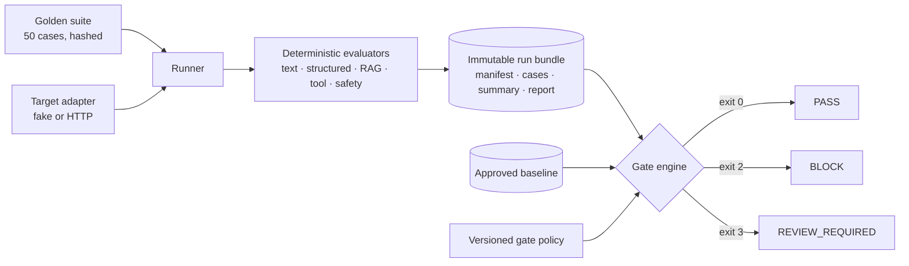

# Automated Eval Harness

A regression gate for GenAI systems. It runs a versioned suite of 50 golden cases against a model or
pipeline, scores every case with deterministic evaluators, compares the result with an approved
baseline, and returns `PASS`, `BLOCK`, or `REVIEW_REQUIRED` before you deploy.

[](https://github.com/pranjulya/automated-eval-harness/actions/workflows/ci.yml)


[](LICENSE)

> A 94% pass rate can still be a release blocker. One forbidden tool call matters more than an
> average, so hard invariants never average away.

## The problem

Teams change prompts, models, and retrieval settings, then judge the result by reading a few outputs.
That misses regressions that matter:

- A model starts calling a destructive tool on 1 case out of 50. The average barely moves.
- A structured output drops a required field. Downstream parsing fails in production, not in review.
- A "quick eval" in a notebook uses different data and thresholds from CI, so nobody trusts either.

This harness gives you one evaluation path, used by the CLI, CI, and the HTTP API alike. It produces
immutable evidence and makes a decision you can defend.

## How it works



| Stage | What it guarantees |
|---|---|
| Suite validation | Exactly 50 synthetic cases, schema-checked, content-hashed (`golden-v1 1.0.1`) |
| Evaluation | Deterministic checks run first. Hard invariants (schema, forbidden tool, secret canary, citation identity) fail the case outright |
| Run bundle | Inputs, config, raw outputs, scores, cost and latency are written once and never mutated. `replay` re-scores from the bundle |
| Gate | Compares with a promoted baseline under a versioned policy. Waivers are scoped, expiring, and can never waive a hard invariant |

## See it work (about 2 minutes, no API key)

```bash
uv sync --extra dev

# 1. Clean run, then promote it to the "stable" baseline
uv run eval-harness run --suite evaluation/datasets/golden-v1 \
  --config evaluation/configs/fake.json --run-id clean
echo '{"actor":"me","approval_evidence":["local-review"],"reason":"first baseline"}' > approval.json
uv run eval-harness promote-baseline --run clean --suite golden-v1 \
  --channel stable --reason "first baseline" --approval-file approval.json

# 2. A candidate with three deliberate defects
uv run eval-harness run --suite evaluation/datasets/golden-v1 \
  --config evaluation/configs/fake-regressed.json --run-id regressed
uv run eval-harness compare --candidate regressed --baseline stable --suite golden-v1
```

Output:

```text
RUN regressed status=completed expected=50 completed=50 pass_rate=0.94 report=artifacts/runs/regressed/report.md
COMPARE candidate=regressed baseline=clean comparable=True decision=BLOCK
  reasons=HARD_INVARIANT_SCHEMA,HARD_INVARIANT_FORBIDDEN_TOOL,FLOOR_CONTRACT,REGRESSION_TOTAL_PASSED,...
```

`eval-harness inspect --run regressed --failures-only` names the three cases: a wrong answer
(`text-001`), a schema break (`struct-001`), and a forbidden tool call (`tool-001`).
The full walkthrough is in [`docs/operations/local-quickstart.md`](docs/operations/local-quickstart.md).

## HTTP API

The API is a thin wrapper over the same application services as the CLI. It is not a second
evaluation path.

```bash
export EVAL_HARNESS_JWT_SECRET=replace-with-a-long-random-local-secret
uv run eval-harness serve --config evaluation/configs/fake.json --port 8080

TOKEN=$(uv run eval-harness dev-token --actor ci --role runner --role reader)
curl -s -X POST localhost:8080/v1/runs -H "Authorization: Bearer $TOKEN" \
  -H 'Content-Type: application/json' \
  -d '{"suite_path":"evaluation/datasets/golden-v1","run_id":"api-run-1"}'
```

Swagger UI is at `http://127.0.0.1:8080/docs`. Roles are `reader`, `runner`, `quality_owner` and
`security_admin`, and the server takes the actor from the verified token, never from the request
body. See [`docs/operations/cli-api-reference.md`](docs/operations/cli-api-reference.md).

## CLI

| Command | Purpose | Exit codes |
|---|---|---|
| `validate` | Check suite schema, counts, and hash | `0` ok · `4` invalid |
| `run` | Evaluate a target, write an immutable bundle | `0` · `5` infra |
| `replay` / `inspect` | Re-score a stored bundle / list failures | `0` |
| `promote-baseline` | Promote a reviewed run with approval evidence | `0` |
| `compare` | Gate a candidate against a baseline channel | `0` PASS · `2` BLOCK · `3` REVIEW_REQUIRED · `4` not comparable |
| `verify-attestation` | Check a gate attestation before deploy | `0` · `2` |
| `serve` / `dev-token` | Run the HTTP API / mint a local token | `0` |

## Key engineering decisions

| Decision | Why | Record |
|---|---|---|
| Deterministic evaluators decide hard invariants; LLM judges never do | A judge can be wrong or manipulated. Safety and contract checks must be reproducible | [ADR-004](docs/architecture/decisions/ADR-004-scoring-model.md), [ADR-006](docs/architecture/decisions/ADR-006-semantic-judging.md) |
| Regression = significant change against a promoted baseline, not a fixed score | Absolute thresholds drift; a baseline is reviewed evidence | [ADR-007](docs/architecture/decisions/ADR-007-regression-policy.md) |
| Immutable filesystem bundles, no database | Evidence must not change after a decision. A file store is enough at V1 scale | [ADR-005](docs/architecture/decisions/ADR-005-persistence-experiments.md) |
| One CLI entry point; the API wraps it | Two evaluation paths always diverge | [ADR-002](docs/architecture/decisions/ADR-002-cli-entry-point.md), [ADR-009](docs/architecture/decisions/ADR-009-http-service-scope.md) |
| Waivers are scoped, approved, expire within 14 days, and never cover hard invariants | Waivers are a release valve, not a way to switch the gate off | [ADR-008](docs/architecture/decisions/ADR-008-ci-and-waivers.md) |
| Unknown or unverifiable state fails closed to `REVIEW_REQUIRED` | A gate that passes on missing evidence is not a gate | [ADR-013](docs/architecture/decisions/ADR-013-v1-scope.md) |

## Quality

```bash
uv run pytest tests -q          # 420 passed, 1 skipped · coverage 91% (gate 85%)
uv run ruff check . && uv run ruff format --check .
uv run mypy src/eval_harness    # strict
```

The tests include failure drills (`tests/e2e/test_production_drills.py`): provider timeouts, corrupted
bundles, partial writes, aborted processes, prompt injection, baseline substitution, waiver abuse,
and PII redaction.

## Project layout

```text
src/eval_harness/
  cli.py, api.py          entry points (CLI is authoritative, API wraps it)
  application/            run, replay, compare, promote, online sampling
  domain/                 cases, runs, gates, baselines, waivers, statistics
  evaluators/             text, structured, rag, tools, safety, invariants
  adapters/               artifact store, target adapters, judges
evaluation/
  datasets/golden-v1/     50 versioned golden cases
  configs/                run configs, gate policy, validation limits
  fixtures/               fake target responses (clean and regressed)
docs/                     PRD, evaluation strategy, HLD/LLD, ADRs, runbooks
Learning/                 guided study material and interview scenarios
```

## Status and limitations

V1 ships the offline deterministic core ([ADR-013](docs/architecture/decisions/ADR-013-v1-scope.md),
[release evidence](docs/operations/release-evidence.md)). Deliberately deferred:

- **Semantic judge gating.** The code is shipped but returns `REVIEW_REQUIRED` until judges are
  calibrated. All `golden-v1` cases are deterministic.
- **Production identity and object store.** Local defaults are an HS256 shared secret and the
  filesystem. API idempotency records and online samples are in memory.
- **No dashboard, scheduler, or database** by design. Add infrastructure only when measured scale needs it.

## Documentation

| Topic | Document |
|---|---|
| Product contract | [`docs/product/PRD.md`](docs/product/PRD.md) |
| Evaluation policy and thresholds | [`docs/evaluation/evaluation-strategy.md`](docs/evaluation/evaluation-strategy.md) |
| Golden dataset contract | [`docs/evaluation/golden-dataset.md`](docs/evaluation/golden-dataset.md) |
| Architecture and threat model | [`HLD`](docs/architecture/HLD.md) · [`LLD`](docs/architecture/LLD.md) · [`threat model`](docs/architecture/threat-model.md) |
| Decisions | [`docs/architecture/decisions/`](docs/architecture/decisions/) |
| Operations | [quickstart](docs/operations/local-quickstart.md) · [runbook](docs/operations/service-runbook.md) · [failure triage](docs/operations/failure-triage.md) · [release checklist](docs/operations/release-checklist.md) |
| Build plan and study path | [`Implementation.md`](Implementation.md) · [`implementation/`](implementation/) · [`Learning/`](Learning/) |

## License

[MIT](LICENSE)
